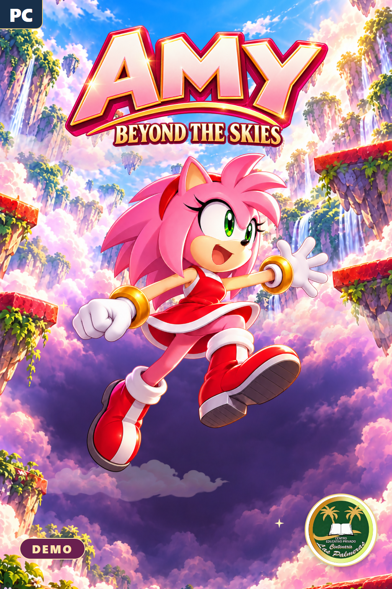
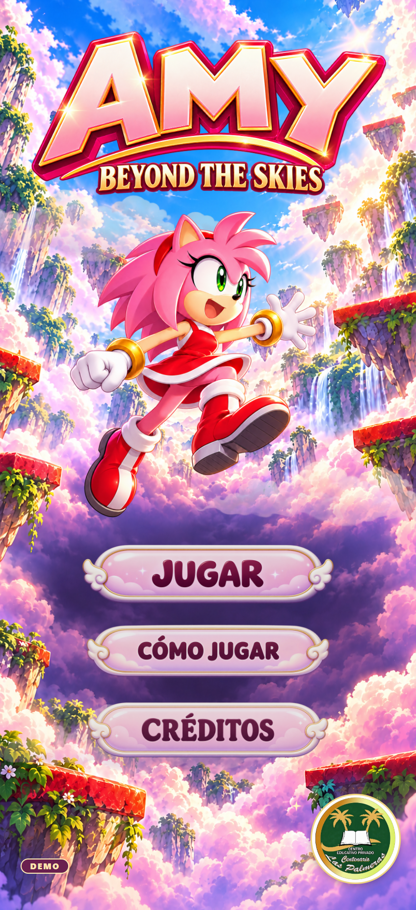
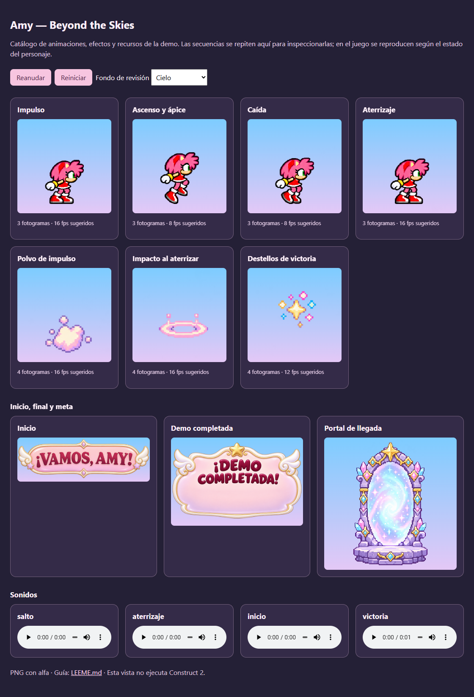

# ✨ Amy — Beyond the Skies (Aventura en el Cielo)

<p align="center">
  
</p>

<p align="center">
  <a href="https://github.com/hfreedo/Amy-Beyond-the-Skies/releases/latest/download/Amy_Beyond_the_Skies_integrado_v2.capx">
    
  </a>
  <a href="https://github.com/hfreedo/Amy-Beyond-the-Skies/releases/latest/download/Amy_recursos_para_integracion.zip">
    
  </a>
</p>

---

## 👋 ¡Bienvenidos al repositorio oficial de Amy: Beyond the Skies!

Este repositorio reúne el proyecto actualizado de **Amy: Beyond the Skies** (desarrollado en **Construct 2**), junto con su hoja de sprites mejorada (`v2`), efectos visuales de salto/aterrizaje/victoria, sonidos, música del menú y guías paso a paso para que los alumnos puedan abrirlo, estudiarlo o continuar mejorándolo.

---

## 📥 1. ¿Cómo descargar el juego? (Guía para alumnos)

Elige la opción que mejor se adapte a lo que necesitas:

1. **Solo quiero abrir el juego actualizado en Construct 2 (Recomendado):**
   - Haz clic en el botón rosa superior **🎮 Descargar Proyecto Construct 2 (`Amy_Beyond_the_Skies_integrado_v2.capx`)** o entra en [`Proyecto/Amy_Beyond_the_Skies_integrado_v2.capx`](Proyecto/Amy_Beyond_the_Skies_integrado_v2.capx) y pulsa **Download raw file**.
2. **Quiero descargar los paquetes `.zip` de recursos y animaciones v2:**
   - Haz clic en el botón violeta **📦 Descargar Kit de Recursos** o entra a la sección [**Releases (Lanzamientos)**](https://github.com/hfreedo/Amy-Beyond-the-Skies/releases), donde encontrarás:
     - `Amy_Beyond_the_Skies_integrado_v2.capx` (Proyecto integrado listo para Construct 2)
     - `Amy_animaciones_actuales.zip` (Paquete de animaciones y sonidos v2)
     - `Amy_recursos_para_integracion.zip` (Kit completo de recursos y documentación)
3. **Quiero descargar todo el repositorio (proyecto, catálogos HTML, música, videos y portadas):**
   - Arriba a la derecha en esta página de GitHub, haz clic en el botón verde **`<> Code`** y selecciona **`Download ZIP`**. Luego descomprime la carpeta en tu PC.

> [!IMPORTANT]
> **Consejo antes de editar en Construct 2:** Parte siempre de **`Proyecto/Amy_Beyond_the_Skies_integrado_v2.capx`** y guarda una copia de respaldo antes de hacer cambios. Los archivos dentro de `Proyecto_Original/` se conservan como referencia histórica de las primeras entregas del equipo.

---

## 🖼️ 2. Vista previa del Menú y Catálogo de Animaciones v2

| Menú Principal Animado | Catálogo de Sprites y Efectos v2 |
|:---:|:---:|
|  |  |

💡 *Al descargar el repositorio, puedes abrir en tu navegador [`Animaciones_v2/Vista_previa.html`](Animaciones_v2/Vista_previa.html) para probar en vivo las animaciones cuadro por cuadro y escuchar los efectos de sonido.*

---

## 🎮 3. Mecánicas y Controles del Juego

- **Ventana del proyecto:** `320 × 700` píxeles (diseño vertical de ascenso continuo).
- **Controles:**
  - **Flechas Izquierda / Derecha (`←` / `→`):** Mover a Amy en el aire hacia las plataformas.
  - **Cruce de bordes laterales:** Si sales por el borde izquierdo de la pantalla, reapareces por el derecho (y viceversa).
  - **Salto automático:** Al aterrizar sobre una plataforma lavanda (`Platform`), Amy rebota automáticamente hacia arriba para seguir subiendo.
- **Inicio y Meta de la Demo:**
  - Al iniciar el nivel se muestra el cartel **«¡Vamos, Amy!»** (`inicio_vamos_amy.png`).
  - Al alcanzar el **Portal de Llegada** (`portal_llegada.png`) en la cima de la demo, se activan los destellos de victoria y el panel **«¡Demo completada!»** (`final_demo_completada.png`) con opciones para volver a jugar o ir al menú.

---

## 🛠️ 4. Guía Técnica para Construct 2 (Hojas de Sprites y Sonidos v2)

### A. Hoja de Personaje (`amy_movimiento_3x4.png`)
Ubicada en [`Animaciones_v2/Assets/Personaje/amy_movimiento_3x4.png`](Animaciones_v2/Assets/Personaje/amy_movimiento_3x4.png).
- **Dimensiones totales:** `1086 × 1448 px` dividida en **3 columnas × 4 filas** (12 celdas exactas de **`362 × 362 px`**).
- **Cómo se usa en Construct 2:** El objeto `Player` original conserva la física (`Platform`) y las colisiones (invisible), mientras que el sprite `AmyVisual` muestra las animaciones siguiendo los pies del jugador:

| Animación en Construct 2 | Fila de la hoja | Fotogramas (índices globales) | Velocidad sugerida | Loop |
|---|:---:|:---:|:---:|:---:|
| `impulso` | Fila 1 | `0, 1, 2` | 16 fps | No |
| `ascenso` | Fila 2 | `3, 4, 5` | 8 fps | No |
| `caida` | Fila 3 | `6, 7, 8` | 8 fps | No |
| `aterrizaje` | Fila 4 | `9, 10, 11` | 16 fps | No |
| `quieta` *(opcional)* | Fila 4 | Solo `11` | 0 fps | No |

📌 *Los puntos de origen exactos (`X, Y`) medidos al pie de cada fotograma están en [`Animaciones_v2/ORIGENES_PERSONAJE.csv`](Animaciones_v2/ORIGENES_PERSONAJE.csv).*

### B. Hoja de Efectos Visuales (`efectos_4x3.png`)
Ubicada en [`Animaciones_v2/Assets/Efectos/efectos_4x3.png`](Animaciones_v2/Assets/Efectos/efectos_4x3.png).
- **Dimensiones totales:** `1448 × 1086 px` dividida en **4 columnas × 3 filas** (celdas de **`362 × 362 px`**):
  - **Fila 1 (`fx_impulso`, frames 0–3, 16 fps):** Polvo al iniciar el salto en los pies.
  - **Fila 2 (`fx_aterrizaje`, frames 4–7, 16 fps):** Impacto suave sobre la plataforma al tocarla.
  - **Fila 3 (`fx_victoria`, frames 8–11, 12 fps):** Destellos mágicos al llegar al portal de meta.

### C. Efectos de Sonido y Música
- **Sonidos de partida (`Animaciones_v2/Assets/Audio/`):** Incluye `salto`, `aterrizaje`, `inicio` y `victoria` en formatos `.wav`, `.ogg` y `.m4a`.
- **Música de menú (`Menu_Animado/Musica/`):** Variantes musicales ambientales celestiales (`Ammy floating...`, `Floating_celestial_menu_loop.mp3`, etc.).

Para consultar todas las instrucciones detalladas de integración y verificación en Construct 2, abre:
- 📄 [`Proyecto/INSTRUCCIONES_PARA_IA.md`](Proyecto/INSTRUCCIONES_PARA_IA.md) — Guía técnica completa paso a paso.
- 📄 [`Animaciones_v2/LEEME.md`](Animaciones_v2/LEEME.md) — Ficha del paquete de animaciones v2.

---

## 📂 5. Estructura de carpetas del repositorio

```text
Amy-Beyond-the-Skies/
├── Proyecto/                                       # Versión vigente integrada
│   ├── Amy_Beyond_the_Skies_integrado_v2.capx      # ⭐ Archivo principal para abrir en Construct 2
│   └── INSTRUCCIONES_PARA_IA.md                    # Guía paso a paso de configuración y eventos
├── Proyecto_Original/                              # Versiones iniciales de referencia de los alumnos
│   ├── amy.capx                                    # Prototipo original de salto
│   └── amy_con_menu.capx                           # Primera versión con menú incorporado
├── Animaciones_v2/                                 # Kit de animaciones corregidas v2 y vistas HTML
│   ├── Assets/                                     # Sprites 3x4, efectos 4x3, carteles, portal y audio
│   ├── ORIGENES_PERSONAJE.csv                      # Coordenadas exactas de origen por fotograma
│   ├── Vista_previa.html                           # Visor interactivo de animaciones y sonidos
│   └── Revision_rodillas.html                      # Comparativa de corrección anatómica del sprite v2
├── Assets_Menu_y_Juego/                            # Biblioteca completa de imágenes separadas (Menú y Nivel)
├── Menu_Animado/                                   # Video MP4 del menú, capturas y pistas de música MP3
└── Portadas/                                       # Ilustraciones promocionales de portada en alta calidad
```
